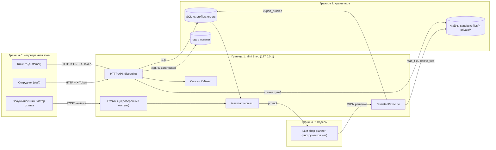

# Модель угроз: Mini Shop + AI-помощник

Учебный стенд, все данные синтетические. Метод: описание системы → границы доверия → угрозы по элементам → меры защиты → проверка (см. `REPORT_01.md`, `lab/test_security.py`).

## 1. Описание системы

- **Клиент** (alice/bob, роль customer) и **сотрудник** (staff) ходят в HTTP API Mini Shop на `127.0.0.1`, аутентификация по токену в `X-Token`.
- **Mini Shop (service.py)**: каталог, заказы, профили, отзывы, файлы чеков, журнал запросов.
- **Хранилища**: SQLite в памяти (profiles, orders), временный каталог файлов (`files/<user>/receipt.txt`, `private/operator-note.txt`), списки reviews/logs в памяти процесса.
- **AI-помощник**: `/assistant/context` собирает prompt из заказа, всех отзывов и вопроса; LLM возвращает JSON `{tool, arguments}`; `/assistant/execute` исполняет инструменты `read_file`, `export_profiles`, `delete_tree`.

## 2. Диаграмма (границы доверия)

Ключевое: отзывы пересекают границу доверия и попадают в prompt; решение LLM пересекает границу обратно и попадает в исполнитель. Оба перехода должны считаться недоверенными.

## 3. Таблица: элемент → угроза → мера защиты

| Элемент | Угроза | Мера защиты |
|---|---|---|
| `POST /login`, сессии | Подбор паролей, нет лимита попыток; токены без срока жизни | Лимит попыток, срок жизни токена, хранение хэшей паролей |
| Все маршруты | Часть маршрутов не проверяет `X-Token`; личность берётся из параметров/заголовков клиента | Единая проверка сессии, владелец и роль только из сессии на сервере |
| `/admin/export` | Роль берётся из заголовка `X-Role`, который задаёт клиент | Роль только из `sessions[token]["role"]` |
| `/profile`, `/search`, `/assistant/context` | SQL-инъекция через конкатенацию строк в запросе; чужие профили | Параметризованные запросы, приведение типов, проверка владельца |
| `/orders` (GET/POST) | Видны чужие заказы; цена принимается от клиента | Фильтр по владельцу, цена только из каталога |
| `/files`, `read_file` | Выход в чужие каталоги и `private/` внутри sandbox | Белый список `files/<свой user>/`, запрет `..`, нормализация |
| `/reviews`, `/reviews/view` | Хранимый XSS; недоверенный текст попадает в prompt | Экранирование HTML, ограничение длины, разметка отзывов как данных |
| `/debug/logs` | Утечка заголовков (токены) и тел запросов | Отключить в проде, маскировать секреты, доступ только staff |
| `/assistant/context` | Prompt injection через отзывы и `question`; чужой `order_id` | Только заказы владельца, отзывы как помеченные данные, фильтрация |
| `/assistant/execute` | Исполнение любого решения LLM без авторизации; `delete_tree` и `export_profiles` доступны всем | Проверка сессии, allowlist инструментов по роли, проверка путей, запрет `delete_tree`, подтверждение человеком |
| Валидация тела и ошибок | `body["x"]` даёт KeyError → 500 с текстом исключения; нет типов и границ | Схема входа, 400/422, нейтральные сообщения об ошибках |
| Доступность | Нет лимитов частоты; журнал и отзывы растут без границ | Rate limit, лимиты размера и количества, ротация журнала |
| Файловое хранилище | Уничтожение всех файлов через `delete_tree` | Нет инструмента удаления у ассистента, бэкап, только свои файлы |

## 4. Чеклист категорий

| Категория | Вердикт | Обоснование |
|---|---|---|
| Math troubles | найдено | Цена заказа берётся из тела запроса без проверки; допускаются отрицательные и нечисловые значения |
| Неактуальность данных | найдено | Контекст помощника берёт заказ по любому `order_id`, отзывы без привязки к продукту и дате, токены не истекают |
| DDoS/перегрузка | найдено | Нет лимитов частоты и размера хранилищ (отзывы, журнал) |
| PII/слив данных | найдено | Профили доступны без владельца, `/admin/export` по заголовку, `/debug/logs` с токенами |
| Fraud | найдено | Подмена цены, подмена роли, заказ от чужого имени через цены |
| Mental health | неприменимо | Сервис не ведёт диалог о состоянии пользователя, ассистент решает только задачу заказа |
| Physical health | неприменимо | Нет медицинских или физических последствий действий сервиса |
| Bad analysis | найдено | Ассистент принимает решение по неочищенному контексту, а сервис исполняет его без перепроверки |
| Prompt injection | найдено | Отзывы вставляются в prompt как есть; исполнитель не проверяет решение (вердикт по модели уточняется в REPORT_01) |
| Вредоносные файлы | найдено | Путь в `/files` и `read_file` не ограничен каталогом пользователя; загрузки нет, но чтение произвольных файлов sandbox возможно |
| Validation error | найдено | SQL по строке, отсутствие проверки типов и обязательных полей, 500 с текстом исключения |
| DB drop | найдено | Нет прямого DROP, но `delete_tree` уничтожает все файлы, а конкатенация SQL оставляет путь к порче данных |

Вердикты «найдено» подтверждены воспроизводимыми проверками в `lab/evidence/before/` (файлы 01–05) и тестами `lab/test_security.py` (13 тестов, все 13 падают на исходном `service.py` — см. REPORT_01.md для разбора по каждой находке).
