# Практика 7.2 — отчёт

## Классификация Issues

Первый тест классификации. Issue #11 о добавлении экспорта в CSV получило метку `feature-request`.

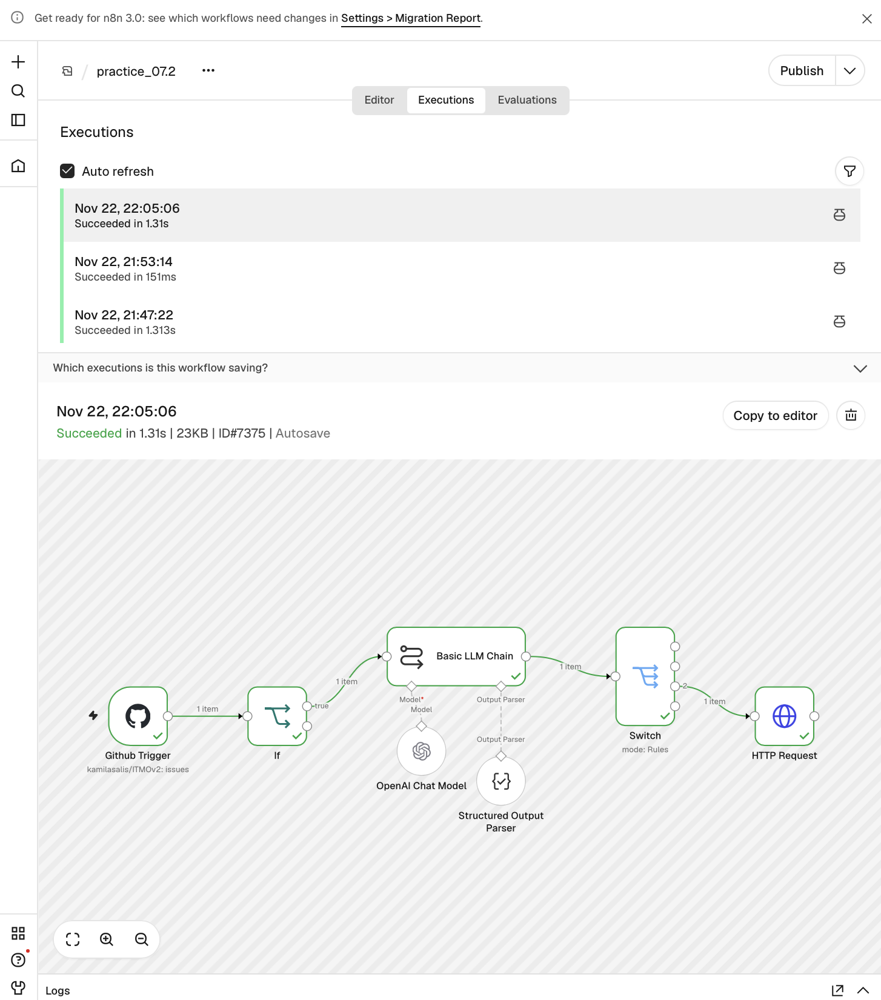

Успешный запуск #7375. Сценарий выбрал выход для `feature` и выполнил запрос на добавление метки.

Запуск #7418 после переноса классификатора. Основной сценарий вызвал `practice_07.2_classifier` и выполнил запрос на добавление метки.

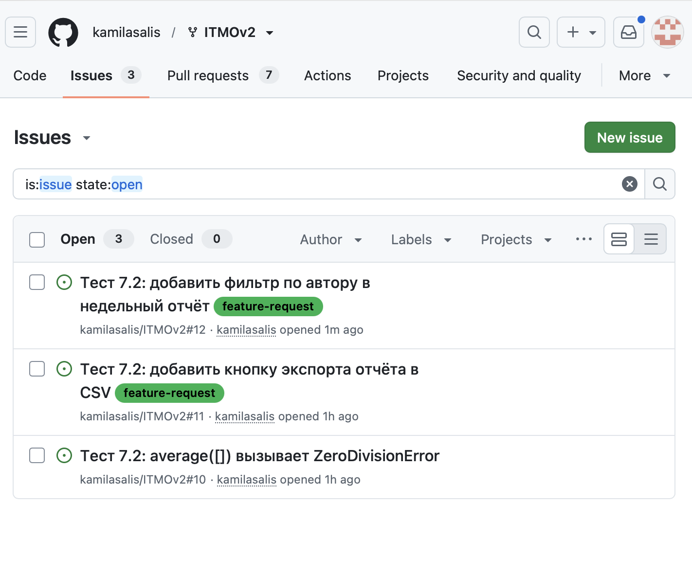

После переноса классификатора новое Issue #12 о фильтре по автору получило метку `feature-request`.

Issue #13 об ошибке `KeyError` получило метку `bug`.

Запуск #7448 прошёл через выход `0` блока Switch и выполнил запрос для метки `bug`.

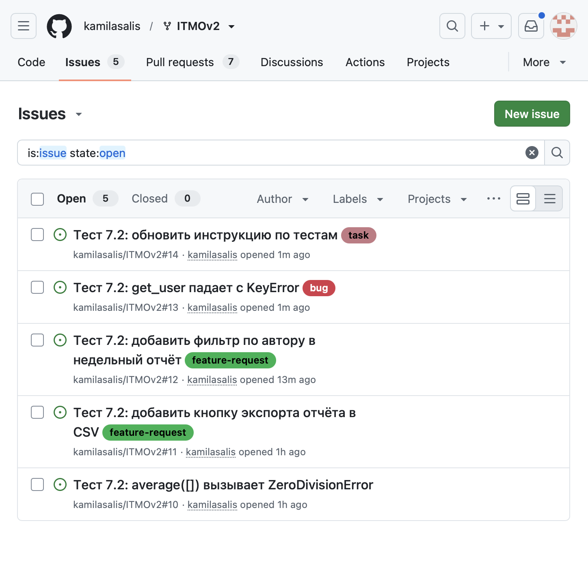

Issue #14 об обновлении инструкции по тестам получило метку `task`.

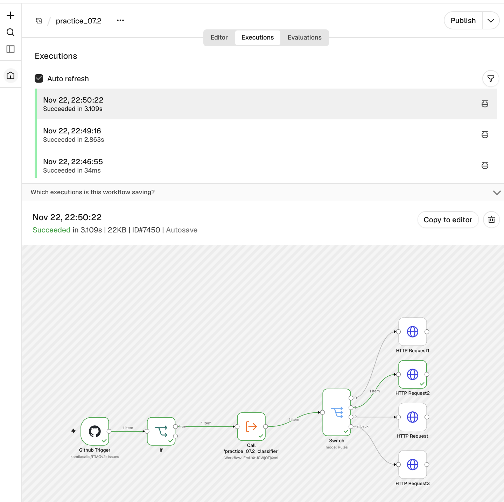

Запуск #7450 прошёл через выход `1` блока Switch и выполнил запрос для метки `task`.

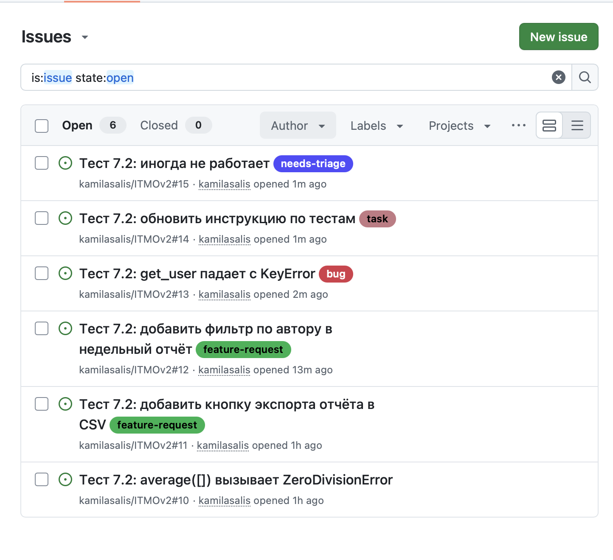

В тестовом репозитории видны все четыре метки — `bug`, `task`, `feature-request` и `needs-triage`.

Запуск #7453 прошёл через запасной выход Fallback и выполнил запрос на добавление `needs-triage`.

Для расплывчатого Issue модель предположила `bug` с уверенностью **0,62**. Это ниже порога **0,8**, поэтому обращение ушло на ручной разбор.

Issue #15 получило `needs-triage`. В обсуждении видна установка метки без публикации комментария.

## Еженедельный отчёт

Расписание отчёта. Cron `0 9 * * 1` задаёт запуск по понедельникам в 09:00.

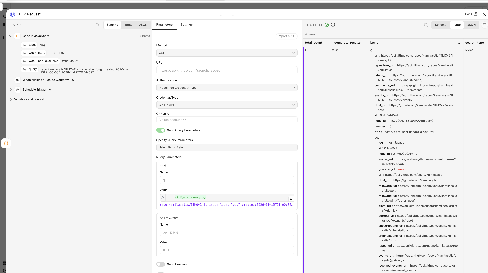

Запрос к GitHub за 16–22 ноября нашёл одно обращение с меткой `bug` — Issue #13.

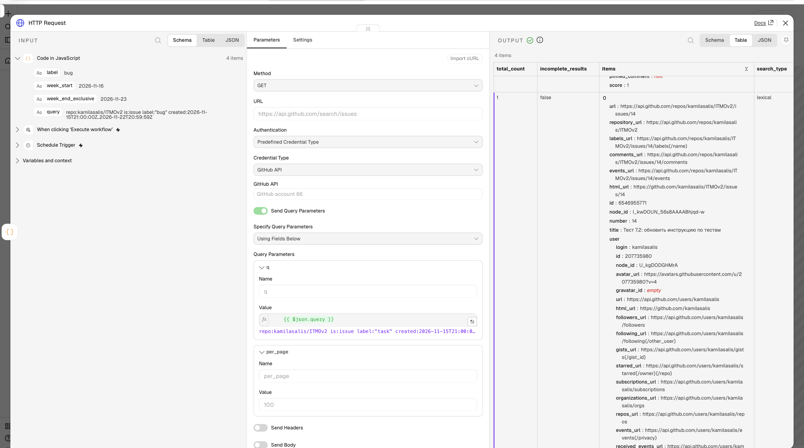

Запрос нашёл одно обращение с меткой `task` — Issue #14.

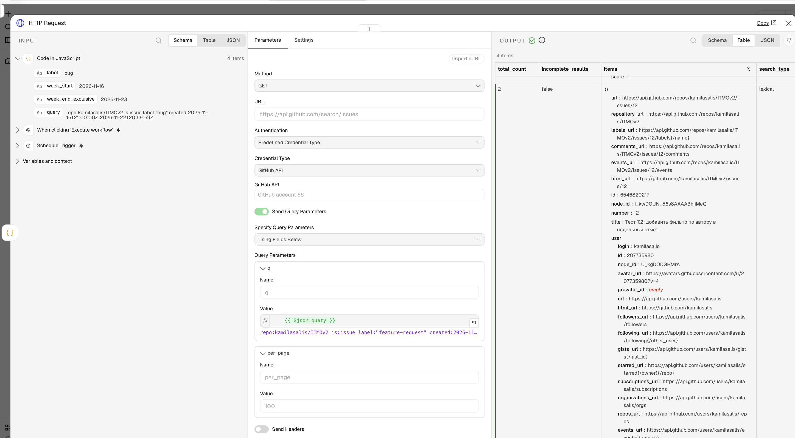

Запрос нашёл два обращения с меткой `feature-request`.

Запрос нашёл одно обращение с меткой `needs-triage` — Issue #15.

В ручном запуске #7529 блок HTTP Request успешно обработал четыре поисковых запроса.

Блок Group weekly issues собрал сводку по типам и авторам. За неделю найдено пять обращений, все от `kamilasalis`.

Полученное HTML-письмо за 16–22 ноября с итогом недели и таблицами по типам и авторам.

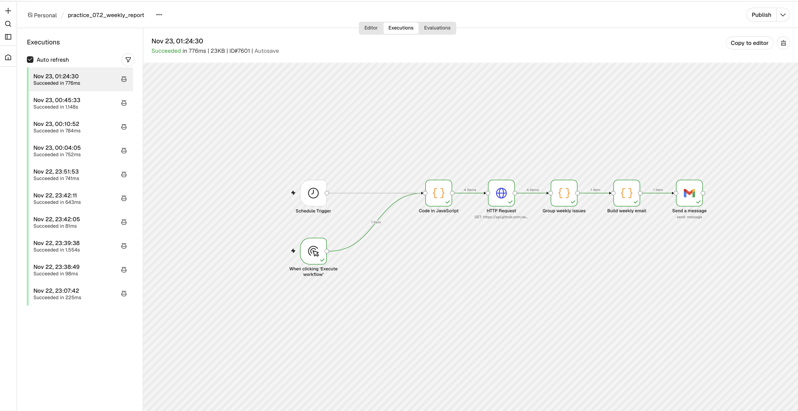

Запуск #7601 успешно прошёл от сбора данных до отправки письма через Gmail.

## Сравнение недель и AI-комментарий

Upsert сохранил в `weekly_issue_stats` сводку за неделю с 16 ноября. В ней пять обращений.

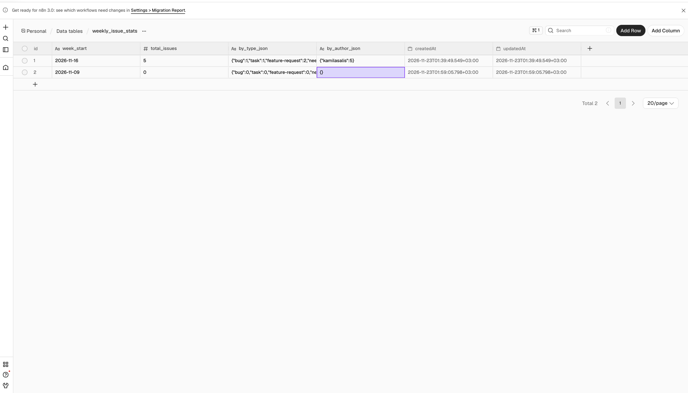

В Data Table две записи. Сводку за 16–22 ноября сохранил сценарий, а строку за 9–15 ноября добавили вручную для теста.

Get row(s) нашёл по дате `2026-11-09` тестовую сводку предыдущей недели с нулём обращений.

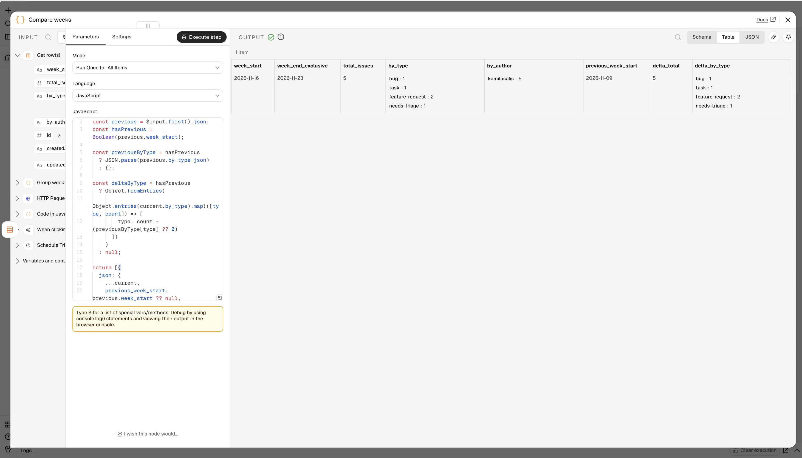

Compare weeks рассчитал общее изменение **+5** и разницу по каждой метке.

Финальное письмо содержит Δ по типам и AI-комментарий. Модель выделила самое заметное изменение — **+2** в категории `feature-request`.

Запуск #7674 успешно сохранил статистику, прочитал предыдущую неделю, рассчитал Δ, сгенерировал комментарий и отправил письмо.
